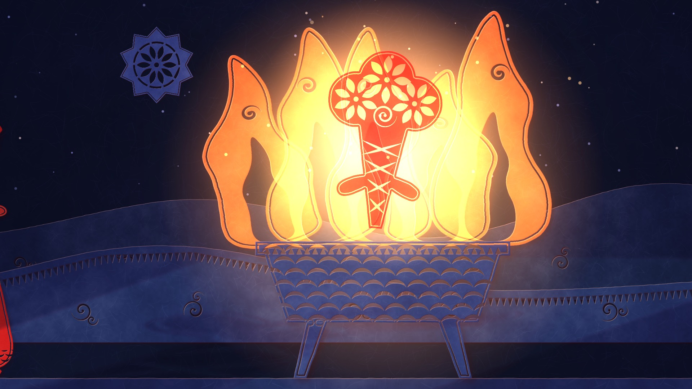
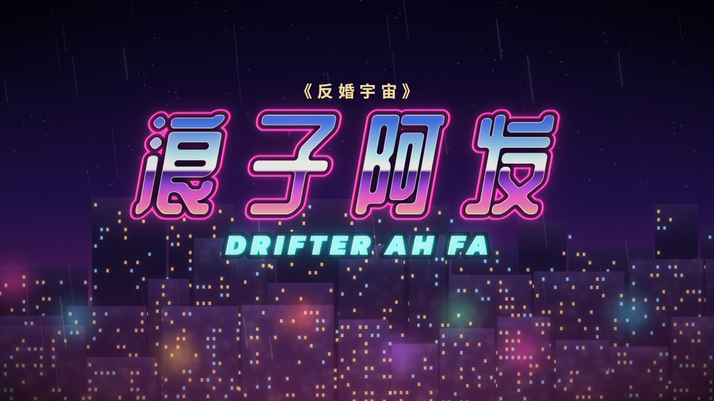

# Anti-Marriage Universe · Music Videos

Three music videos for the album **《反婚宇宙》 (Anti-Marriage Universe)** by Chan Meng. Every frame is drawn in code: no video generation, no stock footage. Each film uses a different visual style from the [Lemo-Opuscar](https://github.com/lemomo-ai/lemo-opuscar) style library.

The album is a trilogy about one blind date in a café, seen three times.

| | Song | Point of view | Visual style | Length |
|---|---|---|---|---|
|  | **《战士阿花》**<br>Warrior Ah Hua | Hers: rebellion | Red Paper-cut | 3:59 |
|  | **《浪子阿发》**<br>Drifter Ah Fa | His: escape | 80s Cel Anime | 4:55 |
|  | **《最佳路人》**<br>The Best Strangers | God's-eye view: both win | Risograph Print | 5:55 |

All three are 1920×1080, 24 fps, mastered to −14 LUFS, with the Chinese lyrics burned in as subtitles and a matching `.srt`.

## Watch

The finished films are too large for a normal Git push, so they are attached to the [latest release](../../releases/latest):

- `ahua.mp4`
- `afa.mp4`
- `passerby.mp4`

## The three films

Ah Hua is always red and Ah Fa is always teal, in all three films.

### Warrior Ah Hua · Red Paper-cut

Red wedding paper is the material of the tradition the song burns down. A paper 囍 (double happiness) is taken apart over four minutes: scissors cut Ah Hua out of the sheet beside it, and in the outro they run down its seam until a single 喜 is left glowing. Each chorus restages the same eight lines at a different age: 28 at the fire basin, the short-haired traveller who rides off on the prince's white horse, and 68 among her sisters. Ah Fa is the only figure cut from teal paper.

### Drifter Ah Fa · 80s Cel Anime

The song is city pop, so the film is a karaoke tape of one life. Verses are rooms: the family dinner, the mill donkey, the matchmaker, a bride catalogue that flips into a "long-term meal ticket", the tower named Responsibility, the mortgage level of an arcade game. Choruses are one motorcycle ride in three colour models: night city, dawn coast, and noon by the sea with Ah Fa at seventy. The car key slapped on the café table in the first seconds comes back at the end as a motorcycle key, set down gently.

### The Best Strangers · Risograph Print

A risograph prints one ink at a time and the plates never quite line up. She is the red plate and he is the teal plate. His memory of the café is printed in teal only, with her as a hole in the paper; hers is printed in red only, with him as the hole. The two plates stay out of register for the whole film and snap true exactly once, on "双向欺诈" (mutual fraud), when it turns out both were acting badly on purpose. At the end the sheet is cut down the middle and the halves leave by opposite edges.

## Repository layout

```
ahua/        Warrior Ah Hua       (Red Paper-cut)
afa/         Drifter Ah Fa        (80s Cel Anime)
passerby/    The Best Strangers   (Risograph Print)
shared/      inputs used by all three films
```

Each film folder holds:

| File | What it is |
|---|---|
| `TREATMENT.md` | The director's treatment: three candidate structures and the one chosen, shot list, beat sheet, cue map |
| `lyrics.json` | Lyric lines aligned to the recording; the single source for subtitles, the `.srt` and the timeline |
| `<name>.srt` | Subtitles |
| `poster.jpg` | Poster frame |
| `stills/` | Model sheets and contact sheets of the final film |
| `CREDITS` | Third-party assets (fonts, engine modules) with source and licence |
| `index.html`, `*.js`, `tools/`, `fonts/` | The film's source: a web page that draws any frame from a time `t` |
| `build.sh` | One-command build |

`shared/` holds the songs (`audio/`), the official lyrics (`lyrics/`), and the beat grids and word-level transcriptions (`timing/`) produced by `tools/analyze.py`.

## How the films are made

1. **Analyse the song.** `shared/tools/analyze.py` extracts a beat grid with librosa and word timestamps with faster-whisper. The transcription is used for timing only; the official lyric text always wins.
2. **Align the lyrics.** Each film's `tools/align.py` matches the official lines to the word timings and writes `lyrics.json`.
3. **Draw.** The film is a page exposing `window.render(t)`. Rendering is deterministic, so any frame can be drawn alone and in any order. Cuts and key actions sit on the song's beat grid.
4. **Render and master.** Headless Chromium captures every frame, ffmpeg encodes them, and the picture is muxed with the untouched song, normalised to −14 LUFS.

The song is the entire soundtrack: no voice-over, no added score, no foley.

## Build

Requirements: Node 20+, ffmpeg, Python 3.11+, and a local clone of [Lemo-Opuscar](https://github.com/lemomo-ai/lemo-opuscar) with its packages installed. The Python environment also needs `librosa` and `faster-whisper` if you re-run the song analysis.

From a POSIX shell (Git Bash on Windows):

```sh
LIB=/path/to/lemo-opuscar sh ahua/build.sh       # or afa/build.sh, passerby/build.sh
```

Each build renders with three workers by default; set `WORKERS=2` to use fewer. A full build takes roughly 10 to 20 minutes per film. On a machine with 16 GB of RAM or less, build one film at a time.

## Credits and rights

- Songs, lyrics and recordings: Chan Meng, from the album 《反婚宇宙》. All rights reserved.
- Films: directed and built with the [Lemo-Opuscar](https://github.com/lemomo-ai/lemo-opuscar) style library. Engine modules copied from it are MIT licensed; see each film's `CREDITS`.
- Fonts are self-hosted subsets under the SIL Open Font License; sources are listed in each film's `CREDITS`.
